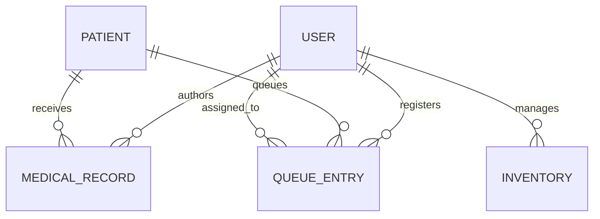

# MongoDB Database Design

## Design Principles

- MongoDB Atlas is the system of record; Mongoose schemas validate application writes.
- Use ObjectIds for document relationships and MAU ID as a unique external identifier.
- Embed bounded, visit-specific vitals, prescriptions, and certificate metadata in a medical record. Reference patients and users to avoid duplicating identity/account data.
- Keep inventory batch-level and make stock deductions atomic.
- Never expose MongoDB documents directly from public endpoints; explicitly project public response fields.
- Store timestamps in UTC. Derive a queue `dateKey` using the `Africa/Addis_Ababa` clinic timezone.

## Collections

### `users` (Mongoose `User`)

| Field | Type | Constraints / use |
|---|---|---|
| `_id` | ObjectId | Primary key |
| `name` | String | Required, max 120 |
| `email` | String | Required, lowercase, unique, max 254 |
| `passwordHash` | String | Required, bcrypt hash, excluded from queries/JSON by default |
| `role` | String | `super_admin`, `receptionist`, `triage_nurse`, `doctor`, `pharmacist` |
| `staffId` | String | Optional MAU staff identifier |
| `isActive` | Boolean | Defaults true; disabled accounts cannot authenticate |
| `lastLoginAt` | Date | Updated on successful login |
| `createdAt`, `updatedAt` | Date | Mongoose timestamps |

Indexes: unique `{ email: 1 }`; `{ role: 1, isActive: 1 }`.

### `patients` (Mongoose `Patient`)

| Field | Type | Constraints / use |
|---|---|---|
| `_id` | ObjectId | Primary key |
| `universityId` | String | Uppercase, unique sparse; required for student/staff, optional for visitor |
| `fullName` | String | Required, max 120 |
| `age` | Number | Required, 0–120; replace with date of birth only after policy review |
| `sex` | String | `Female`, `Male`, `Other` |
| `phone`, `email` | String | Contact data; access restricted |
| `affiliation` | String | `student`, `staff`, `visitor` |
| `campus` | String | `Main Campus`, `Tulu Awulya`, `Ginba` |
| timestamps | Date | Created/updated |

Indexes: unique sparse `{ universityId: 1 }`; text `{ fullName: 'text', universityId: 'text' }`.

### `queueentries` (Mongoose `QueueEntry`)

Fields: patient ObjectId ref, campus, clinic-local `dateKey`, numeric sequence, display `queueNumber`, priority (`routine|urgent|emergency`), status (`waiting|triage|in_consultation|completed|cancelled`), vitals with calculated BMI, `triagedBy`, `triagedAt`, optional assignedDoctor ref, createdBy ref, timestamps.

Indexes: unique `{ campus: 1, dateKey: 1, sequence: 1 }`; unique `{ patient: 1, campus: 1, dateKey: 1 }`; operational lookup `{ campus: 1, dateKey: 1, status: 1, priority: 1, sequence: 1 }`; patient lookup `{ patient: 1, dateKey: 1, status: 1 }`.

### `counters` (Mongoose `Counter`)

The string `_id` is `${campus}:${dateKey}` and `sequence` is incremented atomically with `findOneAndUpdate`. Registration should create patient, counter, and queue entry in one MongoDB transaction on Atlas.

### `medicalrecords` (Mongoose `MedicalRecord`)

Fields: patient ref, provider ref, campus, encounter timestamps, vitals (`bloodPressure`, `temperatureC`, `pulseRate`, `spo2`, `weightKg`, `heightCm`), diagnosis, notes, bounded embedded prescriptions, optional sick-leave document, and timestamps.

Prescription subdocuments: medicine name, dosage, instructions, optional quantity, and state (`pending|partially_dispensed|dispensed`). Sick-leave fields: dates, reason, state (`pending|approved|declined`), approver ref, and a one-time verification-code hash excluded from ordinary reads.

Indexes: `{ patient: 1, createdAt: -1 }`; `{ provider: 1, createdAt: -1 }`.

### `inventories` (Mongoose `Inventory`)

Fields: name, category, batch number, non-negative integer quantity, unit, reorder level, expiry date, createdBy ref, and timestamps.

Indexes: unique `{ name: 1, batchNumber: 1 }`; `{ expiresOn: 1, quantity: 1 }`. Dispensing uses a conditional atomic update matching both sufficient quantity and an unexpired batch.

### `contactmessages` (Mongoose `ContactMessage`)

Fields: full name, optional university ID, lowercase email, controlled campus, subject, message, follow-up state, and timestamps. Public writes are rate-limited; reading messages must be restricted to authorized staff (inbox API is not yet implemented).

Index: `{ createdAt: -1, campus: 1 }`.

## Relationships

## Data Lifecycle and Security

- Medical records are never deleted as a side effect of deleting a user; disable accounts and retain actor IDs for audit.
- Do not persist a certificate verification code in plaintext. Generate a random code only on approval; persist its SHA-256 hash and show the plaintext once to the approving provider for secure delivery.
- The current implementation does not define legal retention, archival, backup, or deletion periods. MAU and applicable counsel must approve these before launch.
- Atlas production configuration must enable TLS, encryption at rest, restricted network access, least-privilege database credentials, backups, and monitoring.

## Migration Note

The repository previously used PostgreSQL BIGINT IDs. This project now connects to MongoDB, but no automatic data migration is included. Keep the existing PostgreSQL database untouched until MAU approves a field mapping, reconciliation process, downtime window, and tested rollback plan. The legacy `backend/src/config/schema.sql` is not executed by the MongoDB setup script.
