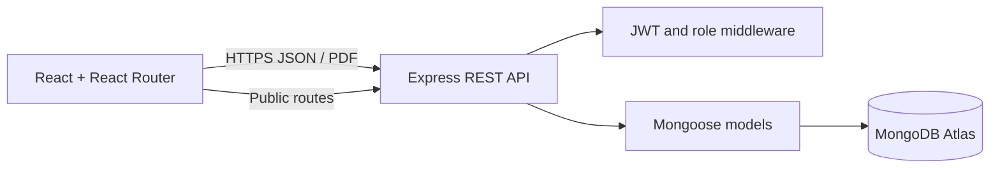

# Project Proposal: MAU Clinic Management System

## Executive Summary

Build a secure, responsive web platform for the Mekdela Amba University Clinic serving Main Campus, Tulu Awulya, and Ginba. The system will coordinate patient registration, daily queues, triage, clinical encounters, medical certificates, pharmacy inventory, and public clinic information through one browser-based application.

The proposed stack is React, Vite, Tailwind CSS, and React Router for the client; Node.js and Express for the REST API; MongoDB Atlas and Mongoose for persistence; and short-lived JWT access tokens with bcrypt password hashing for staff authentication.

## Problem and Opportunity

Clinic workflows commonly span reception registers, queue lists, paper notes, medicine stock cards, and separate certificate records. This makes patient hand-offs and reporting difficult, increases duplicate data entry, and complicates stock and expiry monitoring. A shared system can make the current visit visible to authorized staff while keeping clinical details private from public-facing services.

## Objectives

- Provide consistent clinic workflows across all three campuses.
- Identify university patients using MAU IDs while supporting visitors.
- Reduce manual queue management and improve visibility of urgent cases.
- Maintain a longitudinal record of encounters, vitals, diagnoses, and prescriptions.
- Track batch-level medicine stock and expiry dates, with safe dispensing controls.
- Give patients limited self-service access to queue status and approved certificates.
- Establish auditable role boundaries, secure authentication, and a maintainable API.

## Users

- Super Admin (MAU ICT): staff accounts, roles, system configuration, audit and recovery operations.
- Receptionist: identity lookup, registration, and queue creation.
- Triage Nurse: vitals, priority, and clinician assignment.
- Doctor / Health Officer: encounter notes, diagnosis, prescriptions, and certificates.
- Pharmacist: prescription fulfillment, stock adjustments, and expiry monitoring.
- Students, staff, and visitors: public information, queue lookup, and certificate retrieval where eligible.

## Scope

### Included

- Responsive Home, About, Services, Contact, and Patient Portal routes.
- Staff login using JWT and administrator-controlled account provisioning.
- Patient records and per-campus daily queue numbers.
- Triage and consultation records, prescriptions, and sick-leave approval.
- Batch-aware inventory and non-negative atomic stock deductions.
- Public contact submission, queue lookup, and code-protected certificate PDF download.
- MongoDB schemas, API documentation, configuration, and operational requirements.

### Deferred Until MAU Supplies or Approves

- Verified hotline numbers, office email addresses, maps, opening schedules, and live operational status sources.
- Appointment capacity and scheduling rules.
- Production identity proofing, MFA/SSO, SMS/email delivery of certificate codes, and patient account lifecycle.
- Audit retention, backup retention, data residency, disaster recovery targets, and legal/privacy review.
- Migration of any existing PostgreSQL records into MongoDB.

## Architecture

The API is the source of truth. Public endpoints return only minimum necessary data and are rate-limited. Protected endpoints require a bearer token and role authorization. The current codebase is a starter implementation: its staff dashboard still uses browser-local sample data and must be wired to the API before clinic rollout.

## Delivery Plan

1. Confirm MAU workflow, campus configuration, identity fields, emergency contacts, certificate policy, and data migration requirements.
2. Complete backend workflow endpoints, validation, auditing, and automated tests.
3. Connect staff screens to the API; remove sample data from production builds.
4. Perform privacy/security review, accessibility testing, load tests, and restore drills.
5. Pilot at one campus with trained users; then deploy to remaining campuses with monitoring and support.

## Success Measures

- Every active patient has one campus-specific daily queue entry and an auditable status history.
- Authorized staff can find a patient and record an encounter without duplicate identity records.
- Dispensing never reduces stock below zero or permits expired-batch dispensing.
- Public queue lookup does not disclose names, diagnoses, prescriptions, or contact details.
- Staff actions are attributable and role-restricted; backup restoration is demonstrated before launch.
- Clinic leadership approves measured reductions in waiting and stock reconciliation time after pilot baseline measurement.

## Risks and Mitigations

- **Sensitive health information exposure:** least-privilege roles, private networking, encryption, access/audit review, and no PHI in public responses.
- **MAU ID enumeration:** rate limiting, additional verification for documents, generic errors, and monitoring.
- **Incorrect or incomplete clinic details:** publish hotline/hours only after campus owner verification.
- **Migration loss or mismatch:** keep the existing database unchanged; use a rehearsed, checksummed, reversible migration plan.
- **Network interruptions across campuses:** define degraded-mode paper procedures and reconciliation before deployment.
- **Operational overclaim:** the current sample dashboard is not a live clinical system and must not be used for real patient care yet.
